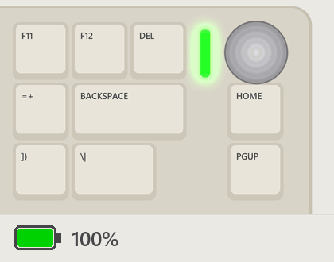

# CIDOO V75 Pro: battery level on the logo light



A small patch for the stock firmware of the CIDOO V75 Pro keyboard (version 0101). The light bar to the left of the knob shows how charged the battery is. Everything else stays the stock firmware: 2.4G, Bluetooth, VIA, the keys and the other lighting modes.

The goal was to make the logo light useful, not just a blinking decoration: the stock firmware shows the battery level nowhere except on a key combination, and this keyboard has no app that shows it either.

## What the light bar shows

Turn it on: **Fn+PgUp** to the solid colour logo mode, then **Fn+PgDn** to the colour after purple. That slot used to be white.

| State | Light bar |
|---|---|
| On battery, 100-20 % | Steady. The colour moves from green through yellow and orange to red |
| On battery, below 20 % | Red flash every 2 seconds: quick rise, slow fade |
| Cable in, charging | Green fills the bar from bottom to top, holds, goes out together; every 4 seconds |
| Cable in, charged | Slow green flash every 4 seconds: quick rise, slow fade |

- Below 20 % on battery the stock firmware turns the key lighting off and blinks Fn. That stays as it is; the light bar flashes on top of it.
- The other logo colours and modes work as before. The white logo colour is gone: its slot is the battery colour now.
- The battery percentage is the one the stock firmware measures, the same that Fn+B shows on the keys.
- Only the light bar, no key lighting: press **Fn+Down** until the keys are dark (10 steps). The light bar stays on. **Fn+Backspace** switches all lighting off, the light bar included.

## Is it safe

- The patch installs over the USB cable with the keyboard's own update protocol. Nothing to open, no programmer.
- The keyboard keeps two firmware slots. An update is written to the free one, and the keyboard switches to it only after the whole image has arrived and its checksum matches. A cable pulled halfway leaves the old firmware running.
- The patch changes 14 bytes of the stock firmware (three jumps and the size field) and adds 692 bytes of its own code after it. Its code does nothing until the battery colour is selected, so the first start after the install runs only stock code.
- Going back is one command: `python install.py --restore` writes the original firmware.
- What would need a programmer is a firmware that hangs at start-up. Given the above this is unlikely, but **you use this at your own risk** and without any warranty.

## Install

You need Windows, macOS or Linux, Python 3.8 or later and the `hidapi` package:

```
pip install hidapi
```

1. Charge the keyboard. Connect it with its USB cable, mode switch in the wired position.
2. With Fn+PgDn set the logo to any normal colour, so that the new code stays idle on the first start.
3. Run, from this folder:
   ```
   python install.py
   ```
   It downloads Epomaker's official updater `V75PRO.zip`, takes firmware 0101 out of it, checks it byte for byte, applies the patch, checks the result, asks, and writes it to the keyboard (about 20 seconds). Keep the cable in until it says it is done.
4. Fn+PgUp to the solid colour mode, Fn+PgDn to the colour after purple.

`python install.py --check` does everything except talking to the keyboard. With `--updater V75PRO.zip` it uses a file you downloaded yourself.

On Linux, access to the keyboard may need root or a udev rule for 320F:5055. On macOS the terminal needs the Input Monitoring permission.

## Going back

```
python install.py --restore
```

This writes the original firmware 0101 from the same official updater.

## How it works

The keyboard runs on a Telink TLSR8278. Its firmware is not encrypted; the official updater carries it as a plain image. The patch hooks into the stock lighting code at three places:

| Address | Stock code | Now |
|---|---|---|
| `0xb41c` | Call of the "solid colour" logo routine | Calls `logo_normal`: the battery colour if it is selected, otherwise the stock routine |
| `0xb66e` | Low battery branch, after the lights were cleared | `logo_low`: what the stock code did, then the red flash |
| `0xb558` | Low battery branch, between its slow refreshes | `logo_low_fast`: the flash at the normal frame rate |

The new code sits after the end of the stock image. It reads the battery percentage the stock firmware keeps, the charger pins and the 16 MHz system timer; brightness uses a gamma of 2, so the fades look even.

- `src/` the patch: `logo.c`, `hooks.S`, `patch.ld`
- `patch/logo-patch.hex` the patch built from `src/` (only the new code and the three jumps, no CIDOO code)
- `install.py` the installer; `build.py` rebuilds the patch: `python build.py --tc32 <folder of tc32-elf-gcc>`
- `tools/telink_ota.py` sends an image to the keyboard
- `docs/make_gif.py` draws the animation above with the same arithmetic as the firmware

## Credits

- `tools/telink_ota.py` comes unchanged from [goyamamoto/zmk-tc32](https://github.com/goyamamoto/zmk-tc32) (commit `8fc7fa0`, GPL-3.0-or-later). That project is a fully open ZMK firmware for this keyboard: [goyamamoto/tc32-keyboards](https://github.com/goyamamoto/tc32-keyboards).
- The TC32 compiler: [devbis/tc32](https://github.com/devbis/tc32). Disassembly: Ghidra with [leommxj/ghidra_tc32](https://github.com/leommxj/ghidra_tc32).

## Made with

The firmware analysis, the patch, the installer and the animation were made with Claude Opus 5.5 (Anthropic) in Claude Code.

## License

GPL-3.0-or-later, see [LICENSE](LICENSE). The CIDOO firmware is not part of this repository and remains CIDOO's; the installer downloads it from Epomaker's website. Not affiliated with CIDOO or Epomaker.
